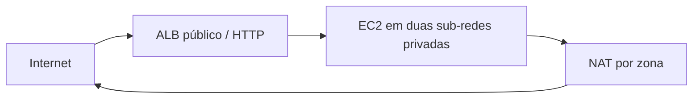

# CloudFormation: referências entre stacks

Laboratório que separa rede, NAT, Application Load Balancer e Auto Scaling em stacks independentes, ligadas por Outputs/Exports e `Fn::ImportValue`.

## Arquitetura



## Templates

| Ficheiro | Função |
| --- | --- |
| `cross-ref-vpc-subnets.yaml` | VPC, quatro sub-redes, Internet Gateway e security groups; exporta os IDs |
| `cross-ref-natgateway.yaml` | Dois NAT Gateways e rotas privadas; importa os IDs da rede |
| `cross-ref-alb.yaml` | ALB, listener HTTP e target group; exporta o target group e DNS |
| `cross-ref-autoscaling.yaml` | Launch Template, duas instâncias por defeito e target tracking de CPU |
| `vpc-all-in-one.yaml` | Alternativa autónoma para a rede com NAT; não combinar com as stacks de rede anteriores |

## Pré-requisitos

AWS CLI v2, conta de laboratório, permissões para CloudFormation/EC2/ELB/Auto Scaling e leitura dos parâmetros públicos SSM. Usar uma região com pelo menos duas zonas disponíveis.

A AMI Amazon Linux 2023 x86_64 é resolvida na região através do Parameter Store. Isso não fixa a versão exata do sistema para sempre.

## Implementar

Exemplos para Bash. Executar a partir da raiz deste repositório:

```bash
export AWS_DEFAULT_REGION=us-east-1
aws sts get-caller-identity
aws cloudformation deploy --template-file cross-ref-vpc-subnets.yaml --stack-name practical-cross-vpc
aws cloudformation deploy --template-file cross-ref-natgateway.yaml --stack-name practical-cross-nat --parameter-overrides VpcStackName=practical-cross-vpc
aws cloudformation deploy --template-file cross-ref-alb.yaml --stack-name practical-cross-alb --parameter-overrides VpcStackName=practical-cross-vpc
aws cloudformation deploy --template-file cross-ref-autoscaling.yaml --stack-name practical-cross-asg --parameter-overrides VpcStackName=practical-cross-vpc ALBStackName=practical-cross-alb
aws cloudformation describe-stacks --stack-name practical-cross-alb --query 'Stacks[0].Outputs'
```

Cada deploy aguarda a criação/atualização da stack antes de continuar. Abrir o DNS do ALB por HTTP depois de os targets ficarem saudáveis. A página de teste é criada pelo UserData; não existe uma aplicação de base de dados neste lab.

## Verificação

Confirmar duas instâncias em sub-redes privadas, os targets saudáveis e as rotas por NAT na zona correspondente. Verificar os exports na consola CloudFormation. Um export que esteja a ser importado não pode ser eliminado ou alterado livremente.

## Custos e limpeza

O desenho cria dois NAT Gateways, endereços IPv4, um ALB e pelo menos duas instâncias EC2. O grupo SSH de exemplo contém uma regra ampla; não o associar a uma instância exposta. As instâncias do lab usam o grupo web, cuja entrada é limitada aos grupos previstos.

Eliminar as stacks consumidoras antes das que exportam valores:

```bash
aws cloudformation delete-stack --stack-name practical-cross-asg
aws cloudformation wait stack-delete-complete --stack-name practical-cross-asg
aws cloudformation delete-stack --stack-name practical-cross-alb
aws cloudformation wait stack-delete-complete --stack-name practical-cross-alb
aws cloudformation delete-stack --stack-name practical-cross-nat
aws cloudformation wait stack-delete-complete --stack-name practical-cross-nat
aws cloudformation delete-stack --stack-name practical-cross-vpc
aws cloudformation wait stack-delete-complete --stack-name practical-cross-vpc
```

Estes nomes são os do exemplo; confirmar a conta e os nomes antes de eliminar recursos.

[Fn::ImportValue](https://docs.aws.amazon.com/AWSCloudFormation/latest/TemplateReference/intrinsic-function-reference-importvalue.html) · [Versão com nested stacks](https://github.com/edgarjose/aws-cloudformation-nested-stacks)
